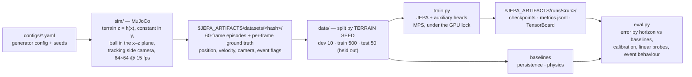
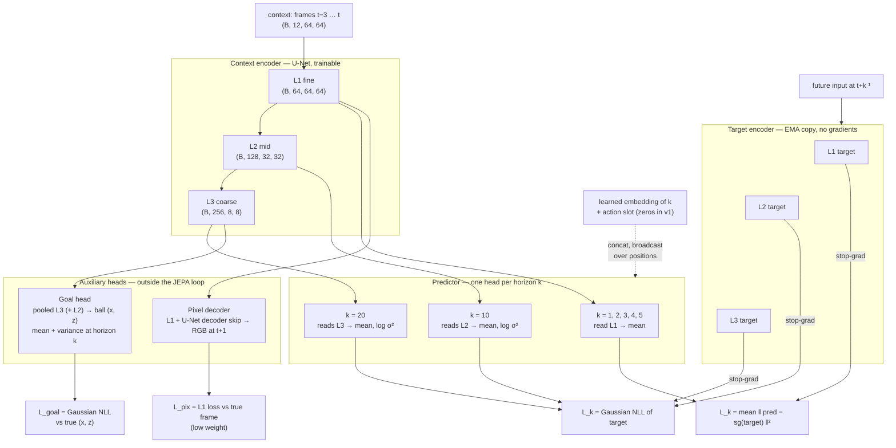
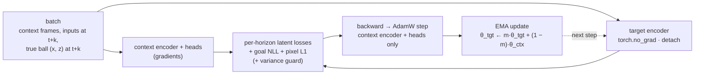
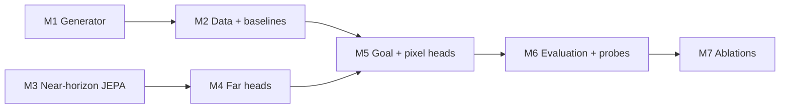
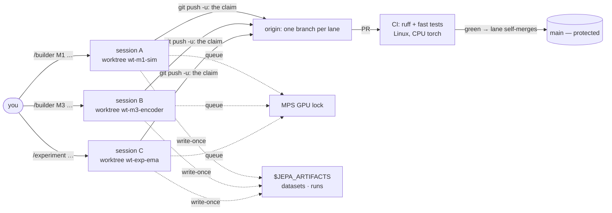

# jepa-world-1

A small, controllable testbed for a **JEPA-style world model with multi-horizon prediction**. A
ball rolls and bounces over procedurally generated terrain, simulated in MuJoCo and rendered
side-on at 64×64. The world has the usual x, y, z axes with z up. In this simple first version the
terrain is constant along y, so its surface is z = h(x) and the ball stays in the x–z plane. Later
versions will use full terrain, z = h(x, y). The model learns to predict *embeddings* of future
frames at horizons of 1 to 20 frames. Fine U-Net levels predict near futures, and coarse levels
predict far futures with explicit uncertainty.

Ground truth is exact (simulator state, not labels), and the hidden physical parameters (radius,
friction, restitution) are known. That lets the embedding hierarchy, uncertainty calibration and
generalisation to unseen terrain all be tested directly.

**[`SPEC.md`](SPEC.md) is the full design and milestone plan.** This page is the map.

## System



Each episode samples hidden ball parameters that the model never sees. Splits are by terrain
seed, so test terrains are never seen in training. Datasets are keyed by a hash of their generator
config and regenerate exactly from it.

## Model



¹ SPEC §4.4 says the target encoder "encodes the frame at t + k with the same architecture". Since
that architecture takes a 4-frame (12-channel) stack, the target input is the stack ending at
t+k, i.e. frames t+k−3 … t+k
([decision](docs/decisions/2026-11-17-target-input-stack.md)). The batch layout that follows
from it is in [`jepa_world/models/DESIGN.md`](jepa_world/models/DESIGN.md).

| Part | Reads | Output | Loss (SPEC §5) |
|---|---|---|---|
| Context encoder | frames t−3…t, (B,12,64,64) | L1 (B,64,64,64) · L2 (B,128,32,32) · L3 (B,256,8,8) | through the heads |
| Target encoder | input at t+k | targets at the level each head reads | none: EMA of context encoder, m = 0.996 |
| Near heads, k = 1…5 | L1 + k-embedding | mean map, L1-shaped | squared distance to stop-grad target |
| Far heads, k = 10 / 20 | L2 / L3 + k-embedding | mean + log-variance maps | Gaussian NLL of target |
| Goal head | pooled L3 (+ L2) | ball (x, z) mean + variance per k | Gaussian NLL, w_goal = 0.5 |
| Pixel decoder | L1 + decoder skip | RGB frame t+1 | L1, w_pix = 0.05 |
| Collapse guard (optional) | context embeddings | — | VICReg-style variance floor |

**Total:** L = Σ_k w_k · L_k + w_goal · L_goal + w_pix · L_pix (w_k = 1). Every term is logged
separately, every step. The JEPA core (`models/jepa.py`) is kept separate from the goal head and
the pixel decoder, so each can be removed without touching the others.

### One training step



Training is staged (SPEC §5.5): near heads and the encoders first, then the far heads, then the
goal head, and the pixel decoder last at low weight.

### What gets measured (SPEC §7)

Every result is reported next to the **persistence** and **physics** baselines, with headline
numbers on held-out terrain seeds:
- position error by horizon, and its ratio to persistence (below 1 means the model wins);
- calibration (fraction of truths inside the 50% / 90% intervals);
- rollout drift;
- linear-probe accuracy for position and the hidden parameters at each level;
- uncertainty before and after out-of-view and occlusion events.

## Milestones



M1 and M3 can be built in parallel: M3 is developed on synthetic tensors with the SPEC shapes.
Completed milestones are summarised in [`docs/milestones/`](docs/milestones/).

## Working on this repo

Several Claude Code sessions work here at once. Each is a **lane**: its own git worktree, branch
and PR.



- **`/builder <chunk>`** is the structured build cycle: worktree, outcome sentence, DESIGN.md,
  tests first, code, `/code-review` + `/verify`, PR, merge.
- **`/experiment <question>`** runs research: hypothesis, committed config, a run under the GPU
  lock, baselines, and a note in `experiments/`.
- **`/verify`** is the definition of done, including an ML-correctness checklist (stop-grad, EMA,
  leakage, determinism, numerics).
- Guards: the `lane_guard` hook blocks commits in the main clone and warns when two lanes touch the
  same file. `tools/lane-owners.sh` shows who is working where, `tools/gpu-status.sh` shows who
  has the GPU, and `tools/finish-lane.sh` removes a merged lane only after checking that nothing
  in it could still be work.

The rules are in [`CLAUDE.md`](CLAUDE.md) and [`docs/process/LANES.md`](docs/process/LANES.md).

## Quickstart

Needs macOS on Apple Silicon (for MPS) or Linux (CPU), plus [uv](https://docs.astral.sh/uv/).

```bash
uv sync            # Python 3.12 venv from uv.lock
./test             # lint + fast tests (~5 s)
./test all         # + slow / render / MPS tiers
```

Datasets and runs are written outside the repo, to `$JEPA_ARTIFACTS` (default
`~/devel/jepa/artifacts/world-1`).

Resolved versions at setup (2026-11-17; `uv.lock` is authoritative): Python 3.12.12 · torch 2.15.0
(MPS on macOS, CPU wheel on Linux) · mujoco 4.0.1 · numpy 2.5.5 · scikit-learn 1.9.1 ·
pyyaml 6.0.3 · tensorboard 2.21.0 · pytest 9.2.0 · ruff 0.17.5.

## Layout

```
SPEC.md            design + milestones          CLAUDE.md / AGENTS.md   agent rules
jepa_world/        sim/ data/ models/ utils/ train.py eval.py baselines.py metrics.py probes.py bench.py
configs/           base.yaml (SPEC defaults) + one yaml per experiment
tests/             fast tier by default; slow / render / mps markers
experiments/       one note per experiment     docs/decisions/   one file per SPEC §9 decision
docs/milestones/   M1–M7 summaries             docs/process/     parallel-work rules
tools/             lane-owners.sh, finish-lane.sh, gpu-status.sh
```

The code lives under one package, `jepa_world/`, rather than SPEC §10's top-level `sim/ data/
models/`, to avoid clashing with other packages named `data` and `models`.
