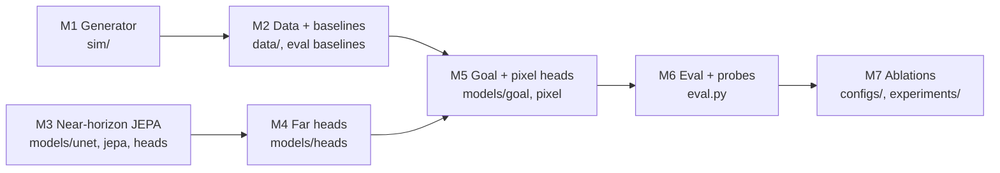

# LANES: how parallel agents stay out of each other's way

Several Claude Code sessions work on this repo at once. Each one is a **lane**: one worktree, one
branch, one PR. These rules exist so that lanes never destroy each other's work, never corrupt each
other's data or benchmarks, and never fight over a shared file.

Who is working where is **derived, never recorded**:

```bash
tools/lane-owners.sh                    # every lane: branch, pushed?, PR state, dirty files, live session
tools/lane-owners.sh path/a.py path/b   # ...and does any other lane hold THESE files? (exit 1 if so)
tools/gpu-status.sh                     # who holds the MPS lock, which jobs are running
```

## The rules

1. **One lane = one worktree, entered with `EnterWorktree`.** `cd` does not move a session: its
   skills, subagents and reviews keep running in the main clone. The main clone (`world-1/`) is for
   `git fetch` and `git pull --ff-only` only. The `lane_guard` hook blocks `git add/commit/push`
   there and warns on edits.
2. **Push your branch the moment you create it** (`git push -u origin HEAD`). The push is your
   claim: atomic, instant, and visible to every other lane. A branch nobody can see is a lane nobody
   can avoid.
3. **Check before you touch shared files.** Run `tools/lane-owners.sh <paths>` before starting. The
   hook warns again at the moment of each edit, since a start-of-work check can go stale. If another
   lane holds a file you need, ask the user which lane takes it. Overwriting another lane's
   *uncommitted* change leaves no conflict marker and nothing to recover.
4. **Small PRs into `main`; CI must be green; the lane merges its own PR**
   (`gh pr merge --merge --delete-branch`). Rebase on `origin/main` if the PR is behind. Never
   force-push `main` (branch protection forbids it anyway).
5. **Data and runs live outside git, under `$JEPA_ARTIFACTS`** (default
   `~/devel/jepa/artifacts/world-1`), shared by every worktree:
   - datasets come only from `paths.build_dataset_once(cfg, build)`. They are hash-keyed and
     write-once, so two lanes asking for the same config get the same directory, built once.
     Bump `sim.generator_version` whenever simulator output changes;
   - runs go only to `paths.new_run_dir(name)`, which makes them unique by construction;
   - never hand-build a path into the artifact root, and never delete another lane's run.
6. **The GPU is shared. Heavy MPS jobs take the lock** (`locks.gpu_lock(label)`): training,
   benchmarks, long evals. A second job waits its turn. Benchmarks must never run without it,
   because a timing taken while another job runs is wrong. Tests run on CPU and never take it.
7. **Add files; don't share tables.** Experiments (`experiments/<date>-<slug>.md`), decisions
   (`docs/decisions/<date>-<slug>.md`) and milestone summaries (`docs/milestones/Mx.md`) are one
   file each. There is no index to update and no sequence number to collide on. Photolok lost a
   day to two lanes both taking requirement id FMA-08.
8. **SPEC.md and SPEC §9 open questions belong to the user.** A lane that needs a §9 decision asks
   and records the answer in `docs/decisions/`. A SPEC.md edit is its own small PR, made with the
   user's say-so.

## Which milestones can run in parallel



M1 and M3 are independent: M3 is built and tested on synthetic tensors with the SPEC §4.2 shapes,
and only M3's *loss decreases on the dev set* test waits for M2. Inside a milestone, split lanes by
**file**, not by feature: two lanes in `models/heads.py` at once is a collision by construction.

## Cleaning up

A lane that has merged its PR removes its own worktree (`ExitWorktree`, remove). Run
`tools/lane-owners.sh` to see the rest. A worktree with no live session might be paused, not
abandoned, so ask the user before removing anyone else's.

## Handshakes

Cross-lane questions that need a durable answer go here, newest first, and get deleted once
settled. For anything quick, message the other session directly (ListAgents / SendMessage). If the
target is ambiguous, ask the user rather than guess.

_None open._
